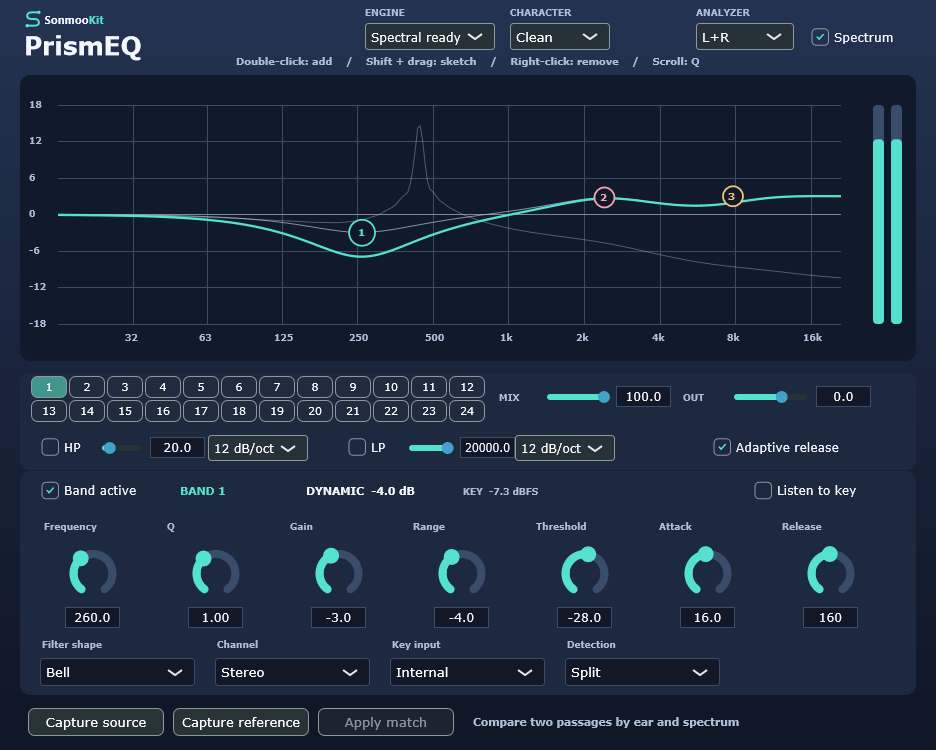
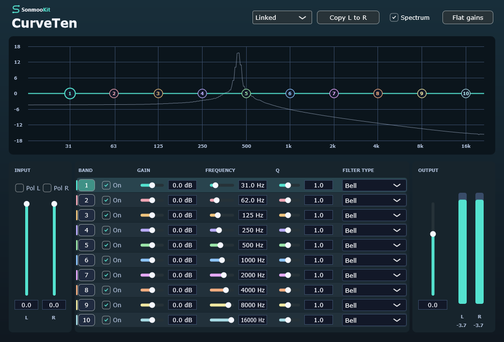
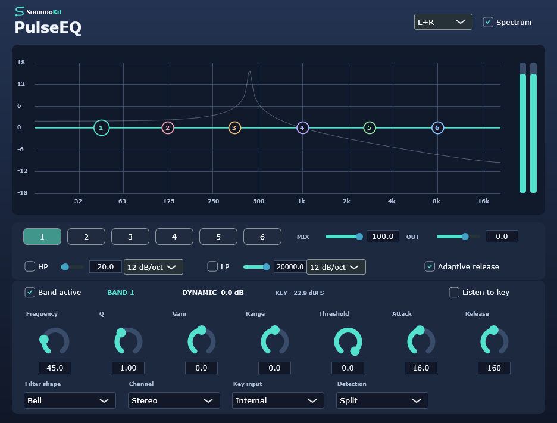
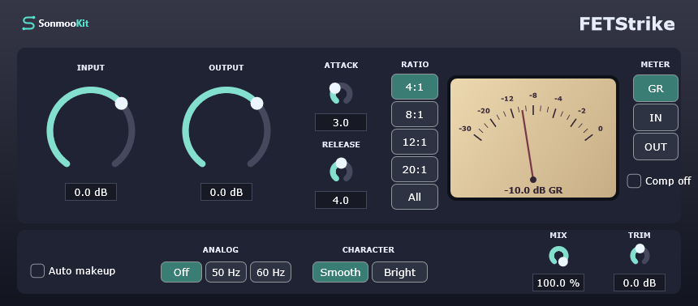
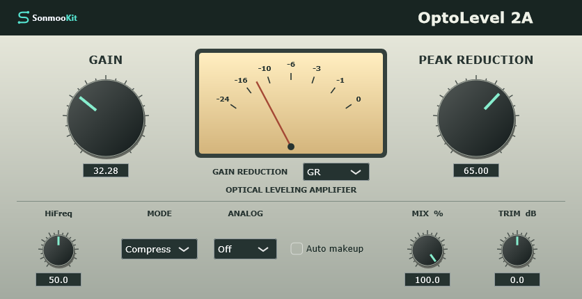
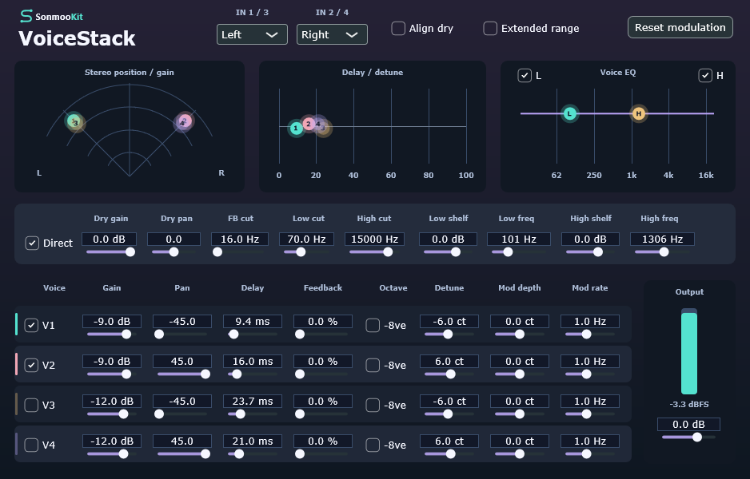
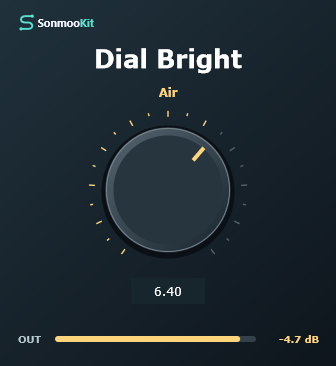
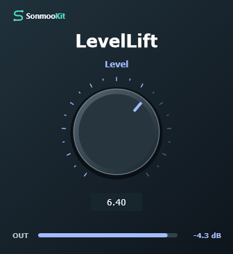
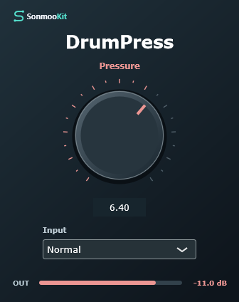
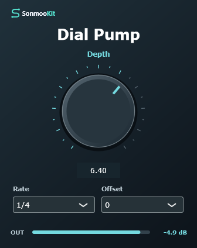

# SonmooKit para FL Studio

Coleção de **20 efeitos VST3 de 64 bits para Windows**. Os plugins rodam nos slots do Mixer do FL Studio, aceitam automação e salvam seus ajustes no projeto.

[Instalação](#instalação) · [Manuais ilustrados](#manuais-ilustrados) · [Série Dial](#série-dial) · [Compilação e testes](docs/compilacao.md) · [Histórico de versões](docs/historico.md)

## Instalação

1. Feche o FL Studio e extraia o pacote VST3 compilado. Se você baixou o código pelo botão **Code → Download ZIP**, siga o [guia de compilação para Windows](docs/compilacao.md) para gerar os plugins.
2. Copie as pastas completas dos efeitos para **SonmooKit** dentro de `C:\Program Files\Common Files\VST3`. Ao final, por exemplo, o equalizador fica em `C:\Program Files\Common Files\VST3\SonmooKit\PrismEQ.vst3`.
3. No FL Studio, abra **Options → Manage plugins**. Marque **Verify plugins** e **Rescan previously verified plugins** e clique em **Find installed plugins**.
4. Abra o **Mixer**, selecione uma pista e escolha o efeito em um slot livre.

**Atualização de uma instalação existente.** Substitua apenas a pasta do efeito que deseja atualizar. Guarde cópias antigas fora dos caminhos de busca do FL Studio para evitar duplicatas. Quem usa automação anterior à versão 0.12.0 pode consultar as [mudanças nas faixas dos parâmetros](docs/revisao-0.12.0.md).

## PrismEQ

Equalizador de 24 bandas com equalização estática, dinâmica de banda e processamento espectral. A versão do código disponível neste repositório é a **0.14.0**. [Manual dessa versão](docs/manuais/PrismEQ.md) · [Comparação com o Pro-Q 4](docs/prismeq-referencia.md)

**No pacote 0.16.6 já distribuído**, selecione uma Bell ou Shelf e escolha **Make Dynamic** ou **Make Spectral**. O controle **GAIN** define o ganho fixo. Arraste verticalmente o marcador de duas setas no gráfico para ajustar **RANGE**, a atuação máxima da banda. Com **GAIN** em 0 dB e **RANGE** em −4 dB, o efeito pode atenuar até 4 dB quando o detector atuar.

## Manuais ilustrados

Clique no nome ou na miniatura para abrir o manual do efeito. A última coluna identifica o plugin usado como referência funcional.

### Equalização

| Painel | Plugin e manual | Função | Referência funcional |
| --- | --- | --- | --- |
|  | [PrismEQ](docs/manuais/PrismEQ.md) | Equalização dinâmica e espectral | FabFilter Pro-Q 4 |
|  | [CurveTen](docs/manuais/CurveTen.md) | Equalizador de dez bandas | Q10 |
|  | [PulseEQ](docs/manuais/PulseEQ.md) | Equalizador dinâmico | F6 |

### Dinâmica e nível

| Painel | Plugin e manual | Função | Referência funcional |
| --- | --- | --- | --- |
|  | [SoftCompressor](docs/manuais/SoftCompressor.md) | Compressão de dinâmica | Renaissance Compressor |
|  | [FETStrike](docs/manuais/FETStrike.md) | Compressor FET | CLA-76 |
|  | [OptoLevel 2A](docs/manuais/OptoLevel2A.md) | Compressor óptico | CLA-2A |
|  | [PeakCeiling](docs/manuais/PeakCeiling.md) | Limitador de picos | L1 |

### Voz, delay e estéreo

| Painel | Plugin e manual | Função | Referência funcional |
| --- | --- | --- | --- |
|  | [SonmooTune](docs/manuais/SonmooTune.md) | Correção de afinação vocal | Waves Tune Real-Time |
|  | [SibilanceControl](docs/manuais/SibilanceControl.md) | Controle de sibilância | Sibilance |
|  | [VoiceStack](docs/manuais/VoiceStack.md) | Dobra de voz | Doubler |
|  | [StereoEcho](docs/manuais/StereoEcho.md) | Delay sincronizado | H-Delay |
|  | [StereoArc](docs/manuais/StereoArc.md) | Imagem estéreo | S1 Imager |

### Série Dial

Oito efeitos com um controle principal. Procure por **Dial** no gerenciador do FL Studio. **Dial Drive** é o antigo DriveTone e aparece uma vez no catálogo. [Guia da série e tabela dos nomes antigos](docs/serie-um-controle.md)

| Painel | Plugin e manual | Função | Referência funcional |
| --- | --- | --- | --- |
|  | [Dial Bright](docs/manuais/AirLift.md) | Brilho progressivo | OneKnob Brighter |
|  | [Dial Bass](docs/manuais/BassBody.md) | Reforço de graves | OneKnob Phatter |
|  | [Dial Drive](docs/manuais/DriveTone.md) | Saturação | OneKnob Driver |
|  | [Dial Filter](docs/manuais/SweepTone.md) | Filtro ressonante | OneKnob Filter |
|  | [Dial Lift](docs/manuais/LevelLift.md) | Elevação de nível | OneKnob Louder |
|  | [Dial Press](docs/manuais/DrumPress.md) | Compressão paralela | OneKnob Pressure |
|  | [Dial Pump](docs/manuais/BeatDip.md) | Pulsação sincronizada | OneKnob Pumper |
|  | [Dial Verb](docs/manuais/RoomBloom.md) | Ambiência e reverb | OneKnob Wetter |
