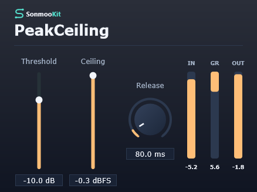
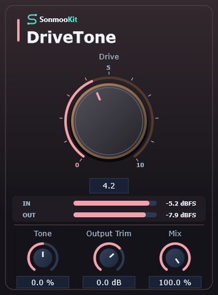

# SonmooKit para FL Studio

Projeto C++ com JUCE 8.0.6. Gera doze efeitos VST3 x64 independentes, com interface própria, medidores em tempo real, parâmetros automatizáveis e restauração de estado no projeto.

| Efeito | Referência funcional | Controles |
| --- | --- | --- |
| [StereoEcho](#stereoecho) | H-Delay | Tempo em milissegundos ou sincronizado ao BPM do host, feedback, filtros, ping-pong e mix |
| [SoftCompressor](#softcompressor) | Renaissance Compressor | Threshold, ratio, ataque, release, knee, makeup e mix paralelo. O detector de pico aplica o mesmo ganho aos dois canais |
| [SibilanceControl](#sibilancecontrol) | Sibilance | Limiar, faixa de redução, largura da detecção, transição Wide/Split, audição do sinal removido, lookahead de 12 ms e histórico do detector |
| [DriveTone](#drivetone) | OneKnob Driver | Drive de 0 a 10, tonalidade, ajuste de saída e mix |
| [PeakCeiling](#peakceiling) | L1 | Threshold, teto de pico de amostra em dBFS, release e lookahead fixo de 2 ms com latência reportada ao host |
| [CurveTen](#curveten) | Q10 | Dez bandas, seis tipos de filtro, curva arrastável, espectro de saída e ganho global |
| [VoiceStack](#voicestack) | Doubler | Quatro vozes com ganho, pan, delay, detune, feedback, oitava e modulação por voz |
| [PulseEQ](#pulseeq) | F6 | Seis bandas dinâmicas, cortes, analisador e sidechain por banda |
| [FETStrike](#fetstrike) | CLA-76 | Compressor FET com Input, Output, tempos, quatro ratios, All e medidor de agulha |
| [OptoLevel 2A](#optolevel-2a) | CLA-2A | Gain, Peak Reduction, Compress/Limit, HiFreq, medidor VU, Analog, Auto makeup, Mix e Trim |
| [StereoArc](#stereoarc) | S1 Imager | Largura, rotação, assimetria, ganho, entrada L/R ou M/S, polaridade, troca de canais e medidores de pico |
| [SonmooTune](#sonmootune) | Waves Tune Real-Time | Correção vocal por escala ou MIDI, tolerância, transições, vibrato, referência e teclado interativo |

## Manuais ilustrados

No FL Studio, abra o Mixer e carregue o efeito em um slot da pista que deseja processar. Na tabela acima, clique no nome do plugin para ir direto ao seu manual.

### StereoEcho

**Delay sincronizado.** Para encaixar as repetições de uma voz no andamento da música, selecione **1/4** em **Tempo sync**. A 120 BPM, cada repetição fica a 500 ms da anterior. Para acertar o intervalo de ouvido, selecione **Off** e ajuste **Time** entre 10 e 2000 ms.

**Feedback** controla quanto de cada repetição volta ao delay. **Low Cut** tira graves das repetições e **High Cut** suaviza seus agudos. Ative **Ping-pong** para alternar os ecos entre esquerda e direita. Em um insert, comece com **Mix** em 25%. Em um canal dedicado ao retorno, use 100% e regule o envio no Mixer.


### SoftCompressor

**Compressão de dinâmica.** Para nivelar uma voz, comece com **Ratio** em 4:1, **Attack** em 10 ms e **Release** em 120 ms. Baixe **Threshold** até o medidor **GR** indicar redução nas palavras mais fortes. Compare o nível de saída com o de entrada e ajuste **Makeup**.

Um ataque mais longo deixa passar mais do início de cada som. **Release** controla quanto tempo o ganho leva para voltar. Aumentar **Knee** suaviza a entrada da compressão perto do limiar. Use **Mix** para combinar o sinal comprimido com o original. O detector aplica o mesmo ganho aos dois canais.


### PeakCeiling

**Limitador de picos.** Para segurar os picos de uma bateria, defina **Ceiling** como o nível máximo de saída desejado. Baixe **Threshold** até **GR** reagir às batidas mais fortes. Se a redução continuar entre batidas, encurte **Release** ou suba o limiar.

**IN** e **OUT** mostram os níveis antes e depois do processamento. O teto é medido em picos de amostra, em dBFS. O limitador antecipa o áudio em 2 ms e informa esse atraso ao host para compensação.



### SibilanceControl

**Controle de sibilância.** Repita um trecho com sons de “s” e “ch”. Ative **Audition sibilance** para ouvir o que está sendo retirado. Ajuste **Detection Width** e **Threshold** até destacar essas consoantes, depois desligue a audição para avaliar a voz inteira.

**Range** limita a redução máxima em dB. Aproxime **Wide to Split** do lado Split para concentrar a redução na faixa detectada. No lado Wide, a atenuação atua sobre o sinal inteiro. Consulte o histórico para localizar os disparos. Ative **12 ms lookahead** quando precisar antecipar o começo das consoantes.


### DriveTone

**Saturação.** Repita um trecho de baixo ou bateria e suba **Drive** a partir de zero. Quando a textura aparecer, use **Output Trim** para comparar o efeito ligado e desligado em volumes parecidos.

**Drive** vai de 0 a 10. **Tone** ajusta o brilho, e **Mix** dosa a presença da saturação. Para preservar o ataque do instrumento, experimente reduzir **Mix** depois de escolher a intensidade do drive. Os indicadores **IN** e **OUT** ajudam a acompanhar a mudança de nível.



### CurveTen

**Equalizador de dez bandas.** Selecione um ponto no gráfico e arraste na horizontal para escolher a frequência e na vertical para ajustar o ganho. Use **Alt** ao arrastar para mudar **Q**. Dê dois cliques no ponto para alternar a banda e comparar o resultado.

Na linha da banda, escolha **Bell** para trabalhar uma região, **Low Shelf** ou **High Shelf** para uma extremidade, e **High Pass** ou **Low Pass** para cortar graves ou agudos. **Proportional Q** oferece uma curva cuja largura depende do ganho. Ative **Spectrum** para acompanhar a saída. Os dois canais compartilham a equalização e têm ajustes de entrada e inversão de polaridade independentes.


### VoiceStack

**Dobra de voz.** Para alargar uma voz principal, mantenha **Direct** ligado e use V1 e V2. Experimente delays de 10 e 20 ms, desafinações de −6 e +6 cents e panoramas opostos. Ajuste o ganho das duas cópias até que a voz principal continue em destaque.

Cada linha controla uma das quatro vozes. **Feedback** cria repetições, **Octave** abaixa uma oitava e **Mod depth/rate** regulam a intensidade e a velocidade da modulação. Os três gráficos permitem ajustar panorama/ganho, delay/detune e a equalização das cópias. **Align dry** alinha o sinal direto e **Reset modulation** reinicia a modulação.


### PulseEQ

**Equalizador dinâmico.** Para atenuar uma ressonância só quando ela aparece, selecione uma banda **Bell**, ajuste a frequência e mantenha **Gain** em 0 dB. Coloque **Range** em −4 dB e baixe **Threshold** até a curva dinâmica se mover nas passagens fortes.

**Attack** e **Release** controlam a entrada e a recuperação da ação. Escolha **Mid** para tratar o centro, **Side** para as laterais ou **Stereo** para ambos. **Split** concentra a detecção na banda e **Wide** usa o sinal de banda larga. Para disparar o efeito com outra pista, encaminhe-a ao sidechain no Mixer e escolha **External** na banda. Use **Listen to key** para conferir o que chega ao detector.


### FETStrike

**Compressor FET.** Selecione **4:1**, ponha o medidor em **GR** e suba **Input** até a agulha responder aos picos. Compense o volume com **Output**. Em **Attack** e **Release**, 1 é o ajuste mais lento e 7 o mais rápido.

Experimente **8:1**, **12:1**, **20:1** ou **All** para mudar a compressão. **Smooth/Bright** seleciona o caráter. **Analog** adiciona hum de 50 ou 60 Hz. **Auto makeup** compensa ganho automaticamente, **Mix** faz compressão paralela e **Trim** ajusta a saída final. Use **IN/OUT** para comparar os níveis e **Comp off** para desligar a etapa de compressão.


### OptoLevel 2A

**Compressor óptico.** Em uma voz com frases de intensidades diferentes, selecione **Compress** e deixe o medidor em **GR**. Suba **Peak Reduction** até a agulha acompanhar as sílabas mais fortes. Ajuste **Gain** para igualar o volume percebido. O ganho unitário fica próximo de 32,28.

**Limit** intensifica a redução. **HiFreq** em 100 deixa o detector plano. Reduza esse valor se os graves estiverem acionando compressão demais. Alterne o VU entre entrada, redução e saída. **Analog**, **Auto makeup**, **Mix** e **Trim** controlam hum, compensação automática, mistura paralela e nível final.


### SonmooTune

**Correção de afinação vocal.** Use uma voz isolada. Escolha a extensão vocal, a tônica e a escala da música. Ligue **Correction** e ajuste sua intensidade. Reduza **Speed** para corrigir mais rápido e aumente **Transition** para suavizar as passagens entre notas. O visor permite comparar entrada e alvo.

Em **Edit scale**, clique nas teclas para incluir ou excluir notas. Com **Group octaves**, a edição vale em todas as oitavas. **Reference tone** toca uma referência e **Hold target** permite segurar o alvo. Para usar o Piano Roll, ative **MIDI target** e envie as notas por um MIDI Out ligado à porta de entrada do wrapper. Ajuste a preservação de formantes e o vibrato ouvindo as vogais sustentadas.


### StereoArc

**Imagem estéreo.** Para abrir um instrumento estéreo, mantenha a entrada em **L/R**, comece com **Width** em 1 e aumente aos poucos. Em 0, a saída fica mono. Em 3, a componente lateral é triplicada. Confira o resultado também em mono.

Arraste no gráfico para ajustar **Rotation** e ganho. Com **Alt**, o gesto controla **Asymmetry** e largura. Rotation move a imagem inteira, enquanto Asymmetry permite ajustar as laterais mantendo uma fonte mono centralizada. Selecione entrada **M/S** para decodificar material gravado em Mid/Side. O seletor dos medidores muda apenas a leitura. **Reset image** restaura largura, rotação e assimetria.


## StereoArc 0.11.0

Processador de imagem estéreo com entrada e saída de dois canais. Em **Width**, 0 soma os canais em mono, 1 preserva a largura original e 3 triplica a componente lateral. **Rotation** desloca a imagem inteira. **Asymmetry** altera as laterais e mantém uma fonte mono no centro.

Arraste no gráfico para ajustar rotação e ganho. Com **Alt**, o mesmo gesto ajusta assimetria e largura. O gráfico representa a configuração da imagem. Os medidores mostram os picos do áudio em L/R ou M/S. Use **Reset image** para centralizar e restaurar a largura original.

Implementação própria baseada nos controles descritos no [manual Waves S1](https://assets.wavescdn.com/pdf/plugins/s1-stereo-imager.pdf).

## OptoLevel 2A 0.10.1

Compressor óptico mono ou estéreo, com detecção vinculada entre os canais e zero amostras de latência declarada. Aumente **Peak Reduction** para comprimir e use **Gain** para acertar o volume. O ponto de referência de ganho unitário é 32,28. Em **Compress**, a curva é mais suave. **Limit** aplica mais redução e ainda permite a passagem dos transientes durante o ataque.

A envoltória tem ataque nominal de 10 ms e dois estágios de recuperação. O estágio lento acumula redução durante sons fortes e sustentados. **HiFreq** em 100 mantém o detector plano. Girar o controle para a esquerda reduz a influência dos graves sobre a compressão. **VU Display** alterna entre entrada, redução e saída. Os medidores de nível usam uma senoide de pico −18 dBFS como referência para 0 VU. **Analog** seleciona ruído e hum de 50 ou 60 Hz, **Auto makeup** compensa parte da perda prevista, **Mix** permite compressão paralela e **Trim** atua sobre a saída final.

No teste a 48 kHz, uma senoide de 1 kHz com pico de −6,02 dBFS, Gain em 32,28, Peak Reduction em 65, HiFreq em 100 e Analog e Auto makeup desligados resultou em 14,41 dB de atenuação em Compress e 20,43 dB em Limit. Em Compress, 300 ms depois de reduzir o estímulo a −60 dBFS, a atenuação residual foi de aproximadamente 1,50 dB após 100 ms de sinal forte e 6,04 dB após três segundos. São medidas deste DSP original.

Referências de projeto: [controles do Waves CLA-2A](https://assets.wavescdn.com/pdf/plugins/cla-2a-compressor-limiter-v16-update.pdf) e [funcionamento da célula óptica do Teletronix LA-2A](https://media.uaudio.com/assetlibrary/l/a/la-2a_manual.pdf).

## SonmooTune 0.9.0

O afinador anteriormente chamado PitchPilot passa a aparecer como SonmooTune. O alvo de compilação continua sendo `PitchPilot_VST3`.

Afinador de voz monofônica com entrada mono ou estéreo. Escolha a extensão vocal, a tônica e a escala. **Speed** ajusta a velocidade da correção e **Transition** suaviza mudanças de nota-alvo. Com as duas tolerâncias ativas, a primeira condição atingida (desvio em cents ou tempo fora da nota) libera a troca. **Link times** usa o tempo de Speed para as transições. O visor mostra o alvo, a correção em cents calculada a partir da razão aplicada e a nota detectada. No teclado, verde indica o alvo e o ponto coral indica a entrada.

Em **Edit scale**, clique em uma tecla para incluir ou excluir aquela classe de nota em todas as oitavas. Clique com o botão direito para escolher correção para cima, para baixo ou bypass da nota. Um alvo MIDI pode substituir essa regra. Desative **Group octaves** para editar só a oitava clicada. O nível de **Reference tone** é ajustável em dB. **Reset keys** restaura a escala. Em **Reference tone**, segure uma tecla para ouvir a referência. Em **Hold target**, segure a nota à qual deseja afinar. Para controlar pelo Piano Roll, envie as notas com MIDI Out para a porta MIDI de entrada do wrapper e ative **MIDI target**. Ao soltar todas as notas, a escala volta a determinar o alvo.

A correção usa detecção de periodicidade e ressíntese granular com preservação opcional de formantes. O controle Vibrato acompanha oscilações recorrentes de afinação. O sinal direto passa sem o atraso fixo de 45 ms da versão 0.8.1. O VST3 declara zero amostras de latência fixa. A detecção e os grãos de correção têm resposta temporal dependente da nota. Use em uma voz isolada. O DSP é próprio. O [manual do Waves Tune Real-Time](https://assets.wavescdn.com/pdf/plugins/tune-real-time-v16-update.pdf) orientou o fluxo de uso. Em bancada a 48 kHz, uma senoide de 451 Hz saiu a 439,88 Hz com correção total e a 445,40 Hz com correção de 50%. A equivalência sonora com o Waves em gravações vocais ainda precisa de comparação direta.

## FETStrike 0.7.0

Compressor estéreo vinculado, com dois caracteres, ruído analógico opcional, mix paralelo, ajuste de saída e medição GR/IN/OUT. Attack e Release vão de 1 (mais lento) a 7 (mais rápido). O modelo de compressão é próprio.

## Versão 0.6.2

Os oito plugins usam a logo SonmooKit nos cabeçalhos, com uma marca vetorial compartilhada.

## PulseEQ 0.6.1

O analisador atualiza a interface a até 60 Hz e usa janelas FFT de 4096 amostras sobrepostas. O traço decai suavemente entre quadros.

## PulseEQ 0.6.0

Oito filtros incluem seis bandas dinâmicas e dois cortes globais. Cada banda tem ganho estático, range dinâmico, limiar, ataque e release, com Stereo/Mid/Side e detector Split/Wide. O sidechain externo usa o bus auxiliar VST3. O espectro mostra a saída e o gráfico compara a curva estática com a curva dinâmica. A resposta do processamento é própria.

## CurveTen 0.5.2

O painel completo mostra as dez bandas e os controles de ganho, frequência, Q e filtro simultaneamente. No gráfico, arraste para editar frequência e ganho, use Alt para ajustar Q e dê duplo clique para alternar a banda. Há faders de entrada e inversão de polaridade por canal, ganho de saída comum e medição estéreo.

## VoiceStack 0.5.1

As quatro vozes ficam visíveis ao mesmo tempo. Os gráficos permitem arrastar panorama e ganho, delay e detune ou frequência e ganho das prateleiras do sinal das vozes. Os controles globais incluem alinhamento do sinal direto, faixa de afinação estendida e reinício da modulação.

## Versão 0.5.0

CurveTen e VoiceStack são efeitos com algoritmos próprios. CurveTen aplica as mesmas bandas aos dois canais. VoiceStack aceita mono, estéreo e mono para estéreo; as vozes usam uma soma mono e o sinal direto preserva o estéreo.

## Interface 0.4.0

StereoEcho destaca o tempo do delay. SoftCompressor e PeakCeiling têm faders e medidores verticais. SibilanceControl dá mais espaço ao histórico da detecção. DriveTone mantém o painel compacto centrado no Drive. Os IDs VST3 e parâmetros dos cinco efeitos foram preservados.

## Compilar no Windows

Requer Visual Studio 2022 com **Desktop development with C++**, Windows SDK, Git, CMake 3.22 ou superior e conexão para obter o JUCE. Execute na pasta que contém este README.

```powershell
cmake -S . -B build -G "Visual Studio 17 2022" -A x64
cmake --build build --config Release --target StereoEcho_VST3 SoftCompressor_VST3 PeakCeiling_VST3 SibilanceControl_VST3 DriveTone_VST3 CurveTen_VST3 VoiceStack_VST3 PulseEQ_VST3 FETStrike_VST3 PitchPilot_VST3 OptoLevel2A_VST3 StereoArc_VST3
```

Os bundles completos ficam em `build/<Efeito>_artefacts/Release/VST3/`. Copie cada pasta `.vst3` inteira para `C:\Program Files\Common Files\VST3`. No FL Studio, abra **Options > Manage plugins**, ative **Verify plugins** e faça a busca. Carregue os efeitos em slots do Mixer. Consulte o [manual de instalação de plugins do FL Studio](https://www.image-line.com/fl-studio-learning/fl-studio-online-manual/html/basics_externalplugins.htm).

## Validação no host

- StereoEcho. Use uma batida curta e renderize com o mix a 100%. Teste 375 ms, sincronização em 1/4 a 120 BPM e a alternância estéreo em ping-pong.
- SoftCompressor. Use um tom de nível constante. Com knee em 0, threshold em −18 dB, ratio 4 e mix a 100%, um pico de −6 dBFS deve estabilizar próximo de −15 dBFS.
- PeakCeiling. Use um sinal com transientes acima do threshold e verifique o teto de pico de amostra. Confira alinhamento com a compensação de latência do Mixer. O teto se aplica a amostras digitais.
- Salve e reabra o projeto do FL Studio para verificar a restauração de parâmetros.

A versão 0.3.0 acrescenta SibilanceControl e DriveTone. Copie os novos bundles para a pasta VST3 e faça uma busca com a verificação de plugins ativada. O modo sem lookahead do SibilanceControl tem latência de processamento declarada de zero. O RAR serviu como referência de inventário e metadados. O processamento é original e o REA não foi executado.
