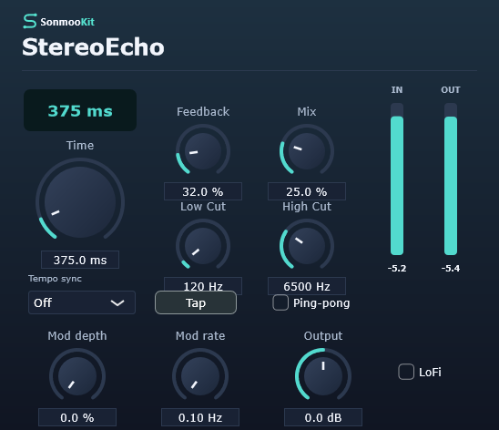
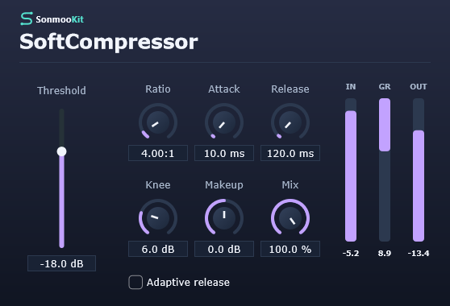
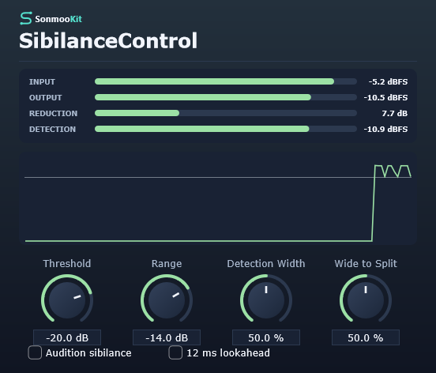
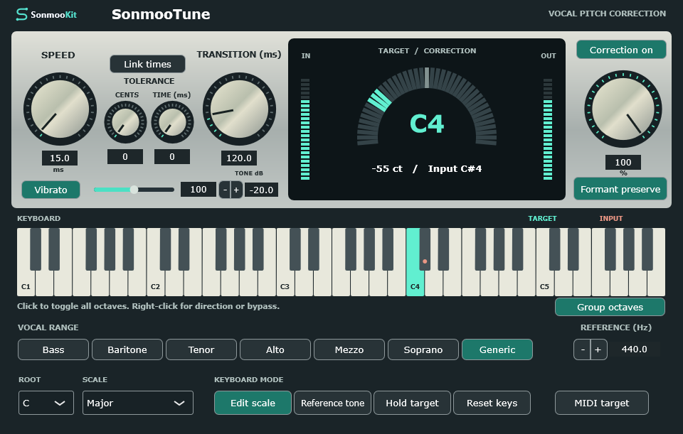
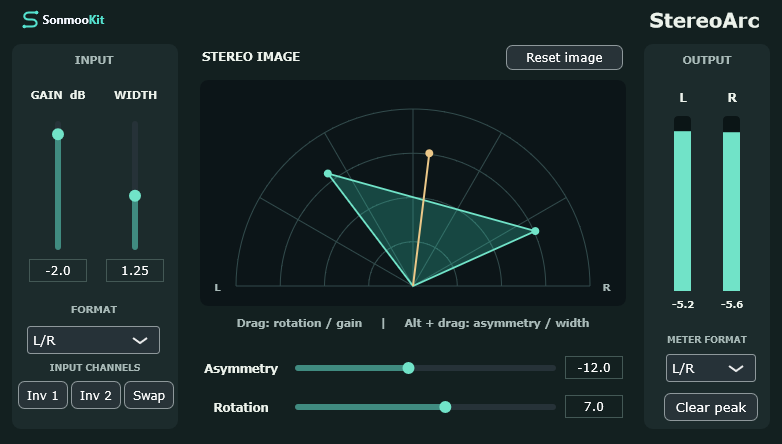
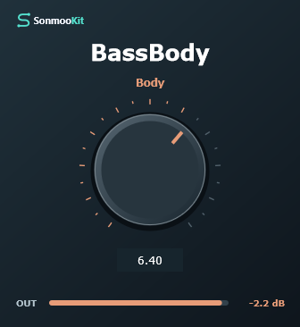
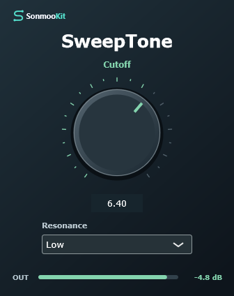
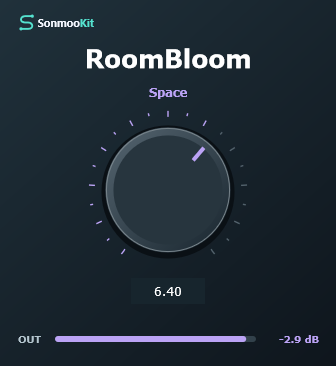

# SonmooKit para FL Studio

Coleção de **19 efeitos VST3 x64 para Windows**, com controles automatizáveis e ajustes salvos no projeto. A coleção base 0.12.1 reúne 12 efeitos. O pacote Série de um controle 0.13.0 acrescenta sete efeitos e inclui o DriveTone já presente na base. Os dois pacotes usam a pasta `SonmooKit`.

[Série de um controle](docs/serie-um-controle.md) · [Instalação](#instalação) · [Manuais ilustrados](#manuais-ilustrados) · [Compilação e testes](docs/compilacao.md) · [Histórico de versões](docs/historico.md)

## Instalação

1. Feche o FL Studio e extraia o ZIP **da coleção compilada**. Copie a pasta **SonmooKit** inteira para `C:\Program Files\Common Files\VST3`. O delay, por exemplo, ficará em `VST3\SonmooKit\StereoEcho.vst3`.
2. Abra **Options → Manage plugins** no FL Studio. Marque **Verify plugins** e **Rescan previously verified plugins** e clique em **Find installed plugins**.
3. No **Mixer**, escolha a pista que deseja processar e carregue o efeito em um slot.

**Se já usa a coleção**, guarde as cópias antigas em uma pasta de backup fora dos caminhos pesquisados pelo FL Studio antes de instalar. Algumas faixas de parâmetros mudaram na versão 0.12.0. Em projetos com automação, compare o resultado com a renderização anterior. [Mudanças e testes de áudio](docs/revisao-0.12.0.md)

## Manuais ilustrados

Clique no nome ou na imagem para abrir o manual. Os controles aparecem com os nomes em inglês que você encontra no painel.

| Painel | Manual | Função | Referência funcional |
| --- | --- | --- | --- |
|  | [StereoEcho](docs/manuais/StereoEcho.md) | Delay sincronizado | H-Delay |
|  | [SoftCompressor](docs/manuais/SoftCompressor.md) | Compressão de dinâmica | Renaissance Compressor |
|  | [PeakCeiling](docs/manuais/PeakCeiling.md) | Limitador de picos | L1 |
|  | [SibilanceControl](docs/manuais/SibilanceControl.md) | Controle de sibilância | Sibilance |
|  | [DriveTone](docs/manuais/DriveTone.md) | Saturação | OneKnob Driver |
|  | [CurveTen](docs/manuais/CurveTen.md) | Equalizador de dez bandas | Q10 |
|  | [VoiceStack](docs/manuais/VoiceStack.md) | Dobra de voz | Doubler |
|  | [PulseEQ](docs/manuais/PulseEQ.md) | Equalizador dinâmico | F6 |
|  | [FETStrike](docs/manuais/FETStrike.md) | Compressor FET | CLA-76 |
|  | [OptoLevel 2A](docs/manuais/OptoLevel2A.md) | Compressor óptico | CLA-2A |
|  | [SonmooTune](docs/manuais/SonmooTune.md) | Correção de afinação vocal | Waves Tune Real-Time |
|  | [StereoArc](docs/manuais/StereoArc.md) | Imagem estéreo | S1 Imager |
|  | [AirLift](docs/manuais/AirLift.md) | Brilho progressivo | OneKnob Brighter |
|  | [BassBody](docs/manuais/BassBody.md) | Reforço de graves | OneKnob Phatter |
|  | [SweepTone](docs/manuais/SweepTone.md) | Filtro ressonante | OneKnob Filter |
|  | [DrumPress](docs/manuais/DrumPress.md) | Compressão paralela | OneKnob Pressure |
|  | [LevelLift](docs/manuais/LevelLift.md) | Elevação de nível | OneKnob Louder |
|  | [BeatDip](docs/manuais/BeatDip.md) | Pulsação sincronizada | OneKnob Pumper |
|  | [RoomBloom](docs/manuais/RoomBloom.md) | Ambiência e reverb | OneKnob Wetter |
