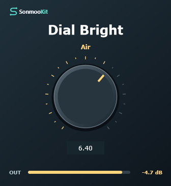

# Dial Bright

[← Catálogo SonmooKit](../../README.md#manuais-ilustrados) · [Guia da série e referências](../serie-um-controle.md)

**Brilho progressivo.** Eleva as frequências altas. Conforme o controle sobe, a região de transição se desloca dos médios-agudos em direção ao ar da gravação.

## Controles

**Air** vai de 0 a 10. O ponto neutro é **0**. Dê dois cliques no botão para restaurá-lo. No extremo da curva, o reforço nominal da prateleira é de 15 dB na região aguda. O medidor **OUT** mostra o pico de saída em dBFS.

Se o chiado ou os esses ganharem destaque, recue Air. Para tratar apenas as sibilantes, use SibilanceControl na cadeia.

## Primeiro ajuste no FL Studio

Em uma voz, alterne entre 0, 3 e 7 durante a mesma frase. Ouça primeiro a articulação das palavras e depois o ar em torno das vogais. Compense o nível no Mixer para comparar.

O parâmetro Air aceita automação e seus ajustes são salvos com o projeto. Referência de uso: [Waves OneKnob Brighter](https://www.waves.com/plugins/oneknob-brighter).
