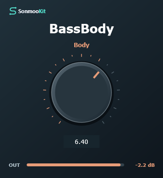

# BassBody

[← Catálogo SonmooKit](../../README.md#manuais-ilustrados) · [Guia da série e referências](../serie-um-controle.md)

**Reforço de graves.** Reforça a região grave com uma prateleira cuja frequência e ganho variam juntos. A intensidade máxima amplia a região trabalhada em direção aos graves médios.

## Controles

**Body** vai de 0 a 10. O ponto neutro é **0**. Dê dois cliques no botão para restaurá-lo. No extremo da curva, o reforço nominal da prateleira é de 14 dB na região grave. O medidor **OUT** mostra o pico de saída em dBFS.

Se o som encobrir a caixa ou perder definição em caixas pequenas, recue Body e compare o grave no contexto da música.

## Primeiro ajuste no FL Studio

Comece em 2 numa pista de baixo e suba enquanto ouve o bumbo junto. Confira se as notas graves ficam mais presentes e ainda se distinguem do ataque do bumbo.

O parâmetro Body aceita automação e seus ajustes são salvos com o projeto. Referência de uso: [Waves OneKnob Phatter](https://www.waves.com/plugins/oneknob-phatter).
