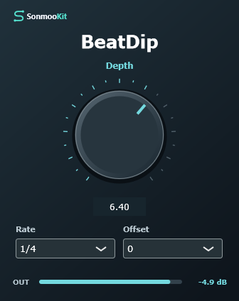

# BeatDip

[← Catálogo SonmooKit](../../README.md#manuais-ilustrados) · [Guia da série e referências](../serie-um-controle.md)

**Pulsação sincronizada.** Cria quedas de volume periódicas com um oscilador sincronizado ao andamento e à posição musical do host. Funciona como efeito de bombeamento sem precisar de uma pista de disparo.

## Controles

**Depth** vai de 0 a 10. O ponto neutro é **0**. Dê dois cliques no botão para restaurá-lo. O medidor **OUT** mostra o pico de saída em dBFS.

Rate oferece 1/1, 1/2, 3/8, 1/4, 3/16, 1/6, 1/8, 1/12, 1/16 e 1/32. Offset desloca o desenho em 0°, 90°, 180° ou −90°. Sem tempo informado pelo host, o efeito usa 120 BPM.

## Primeiro ajuste no FL Studio

Num pad sustentado, ajuste Rate em 1/4, Offset em 0 e Depth em 7. A 120 BPM, a queda se repete a cada 500 ms. Mude para 1/8 para ouvir duas quedas no mesmo intervalo.

O parâmetro Depth aceita automação e seus ajustes são salvos com o projeto. Referência de uso: [Waves OneKnob Pumper](https://www.waves.com/plugins/oneknob-pumper).
