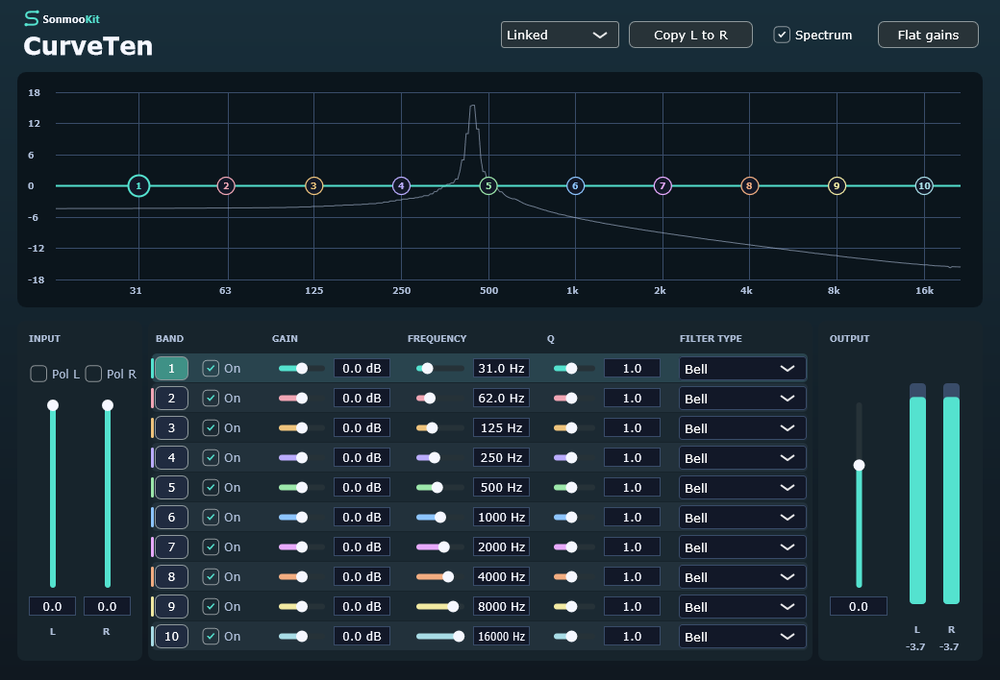

# CurveTen

[← Voltar ao catálogo SonmooKit](../../README.md#manuais-ilustrados)

Equalizador de dez bandas. Referência funcional: Q10.

## Primeiro ajuste

Selecione um ponto no gráfico e arraste na horizontal para escolher a frequência e na vertical para ajustar o ganho. Use **Alt** ao arrastar para mudar **Q**. Dê dois cliques no ponto para alternar a banda e comparar o resultado.

## Controles do painel

| Controle | Como usar |
| --- | --- |
| **Frequency / Gain / Q** | Cada banda cobre de 16 a 21357 Hz e ±18 dB de ganho. Em Bell, aumentar Q estreita a região afetada. |
| **On / número da banda** | Compare uma correção desligando somente sua banda. No gráfico, arraste o ponto para mudar frequência e ganho ou use Alt para ajustar Q. |
| **Filter type** | Bell atua numa região. Os shelves ajustam as extremidades. High Pass e Low Pass cortam a 12 dB/oitava. Proportional Q estreita a curva conforme aumenta a magnitude do ganho. |
| **Linked / Edit Left / Edit Right** | Linked aplica a mesma curva aos dois canais. Em edição independente, confira o lado selecionado antes de mover um ponto. |
| **Copy L to R / Flat gains** | O primeiro copia as dez bandas esquerdas para o banco direito. O segundo zera os ganhos do banco em edição. Os filtros de corte ainda podem atuar. |
| **Pol L / Pol R / Output / Spectrum** | Inverta a polaridade ou ajuste a entrada por canal. Output define o nível final e Spectrum exibe as frequências da saída. |

## O que ouvir

Para corrigir um prato áspero apenas à direita, monte a base em Linked, copie L para R e escolha Edit Right. Desligue e religue a banda para conferir a diferença.
