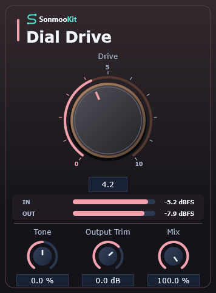

# DriveTone

[← Voltar ao catálogo SonmooKit](../../README.md#manuais-ilustrados)

Saturação. Referência funcional: OneKnob Driver.

## Primeiro ajuste

Repita um trecho de baixo ou bateria e suba **Drive** a partir de zero. Quando a textura aparecer, use **Output Trim** para comparar o efeito ligado e desligado em volumes parecidos.

## Controles do painel

| Controle | Como usar |
| --- | --- |
| **Drive** | De 0 a 10. Define a intensidade da saturação. O nível que chega ao plugin também influencia o resultado. |
| **Tone** | De −100% a +100%. Valores baixos suavizam os agudos da parcela saturada. Valores altos abrem o timbre. |
| **Mix** | De 0 a 100%. Mistura o som direto com o saturado. Reduza para recuperar parte do ataque original. |
| **Output Trim** | De −24 a +12 dB. Compensa o volume após a mistura. |
| **IN / OUT** | Use os níveis de entrada e saída para comparar o timbre com o plugin ligado e desligado. |

## O que ouvir

Para ouvir o que a saturação acrescenta, use a mesma passagem de baixo em loop. Compare Drive em zero com Drive em 4 e compense o volume com Output Trim antes de escolher.
