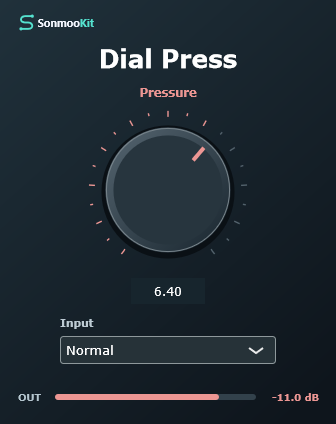

# Dial Press

[← Catálogo SonmooKit](../../README.md#manuais-ilustrados) · [Guia da série e referências](../serie-um-controle.md)

**Compressão paralela.** Combina a fonte direta com uma parcela comprimida e saturada. A macro aprofunda a compressão, aumenta a proporção processada e acrescenta caráter nos ajustes altos. Os canais compartilham o detector.

## Controles

**Pressure** vai de 0 a 10. O ponto neutro é **0**. Dê dois cliques no botão para restaurá-lo. O medidor **OUT** mostra o pico de saída em dBFS.

Input altera o nível enviado à parcela comprimida. Nesta implementação, Pad reduz 6 dB e Boost acrescenta 6 dB. Use Pad com material já muito alto e Boost se a compressão mal reagir.

## Primeiro ajuste no FL Studio

Em um bus de bateria, selecione Input Normal e suba Pressure de 0 a 3. Escute o corpo da caixa e o ambiente entre batidas. Compare com 8 para ouvir a ação mais forte.

O parâmetro Pressure aceita automação e seus ajustes são salvos com o projeto. Referência de uso: [Waves OneKnob Pressure](https://www.waves.com/plugins/oneknob-pressure).
