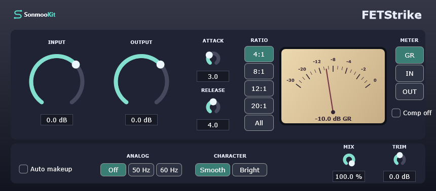

# FETStrike

[← Voltar ao catálogo SonmooKit](../../README.md#manuais-ilustrados)

Compressor FET. Referência funcional: CLA-76.

## Primeiro ajuste

Selecione **4:1**, ponha o medidor em **GR** e suba **Input** até a agulha responder aos picos. Compense o volume com **Output**. Em **Attack** e **Release**, 1 é o ajuste mais lento e 7 o mais rápido.

## Controles do painel

| Controle | Como usar |
| --- | --- |
| **Input / Output** | Ambos vão de −48 a +24 dB. Aumentar Input faz o sinal atingir mais fortemente o compressor. Use Output para acertar o nível da parcela processada. |
| **Attack / Release** | A escala vai de 1 a 7. Em 7, ambos são mais rápidos. O ataque nominal vai de 1 ms a 25 µs e o release de 1 s a 50 ms. |
| **Ratio / All** | Escolha 4:1, 8:1, 12:1 ou 20:1. All usa outra curva e produz uma resposta mais intensa. |
| **Meter / Comp off** | GR indica redução. IN e OUT mostram níveis. Comp off desliga a etapa de compressão. |
| **Analog / Character** | Analog acrescenta hum de 50 ou 60 Hz. Smooth e Bright selecionam o caráter de compressão e saturação. |
| **Auto makeup / Mix / Trim** | A compensação automática recupera parte do volume. Mix permite combinar com o som direto e Trim ajusta o ganho final. |

## O que ouvir

Se o bumbo perder o impacto, aproxime Attack de 1. Se a redução persistir até a batida seguinte, aproxime Release de 7 e acompanhe a agulha em GR.
