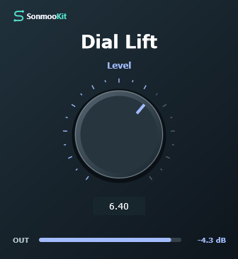

# Dial Lift

[← Catálogo SonmooKit](../../README.md#manuais-ilustrados) · [Guia da série e referências](../serie-um-controle.md)

**Elevação de nível.** Eleva trechos de nível baixo com ganho dependente do detector estéreo. O ganho calculado chega a 24 dB em sinais fracos. A parcela processada passa por limitação de pico de amostra.

## Controles

**Level** vai de 0 a 10. O ponto neutro é **0**. Dê dois cliques no botão para restaurá-lo. O medidor **OUT** mostra o pico de saída em dBFS.

O resultado depende do nível de entrada. Ruído de fundo também pode subir. O controle não estabelece um alvo de loudness integrado em LUFS.

## Primeiro ajuste no FL Studio

Compare uma frase baixa com uma frase forte na mesma pista. Suba Level até entender a frase baixa e confira se a frase forte ainda tem espaço no Mixer.

O parâmetro Level aceita automação e seus ajustes são salvos com o projeto. Referência de uso: [Waves OneKnob Louder](https://www.waves.com/plugins/oneknob-louder).
