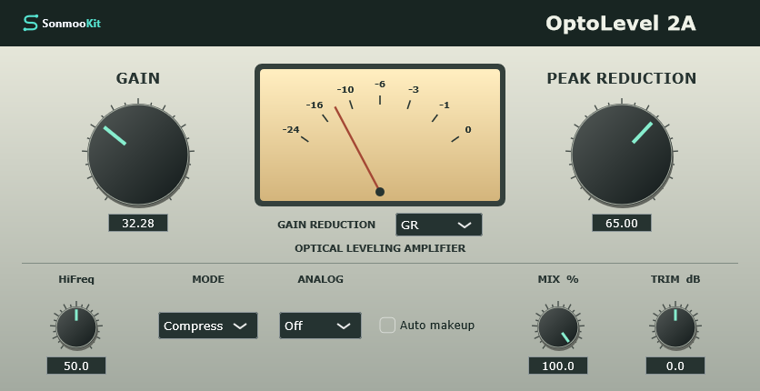

# OptoLevel 2A

[← Voltar ao catálogo SonmooKit](../../README.md#manuais-ilustrados)

Compressor óptico. Referência funcional: CLA-2A.

## Primeiro ajuste

Em uma voz com frases de intensidades diferentes, selecione **Compress** e deixe o medidor em **GR**. Suba **Peak Reduction** até a agulha acompanhar as sílabas mais fortes. Ajuste **Gain** para igualar o volume percebido. O ganho unitário fica próximo de 32,28.

## Controles do painel

| Controle | Como usar |
| --- | --- |
| **Peak Reduction** | De 0 a 100. Aumente até que o VU em GR acompanhe as sílabas ou notas mais fortes. |
| **Gain** | De 0 a 100. O ponto de ganho unitário fica próximo de 32,28. Use Gain depois de acertar a redução. |
| **Compress / Limit** | Compress nivela mais suavemente. Limit intensifica a redução. Transientes curtos ainda podem passar durante o ataque. |
| **HiFreq** | Em 100, o detector fica plano. Reduza se os graves estiverem acionando compressão demais. |
| **VU Display** | In e Out indicam nível e GR indica redução. Uma senoide com pico de −18 dBFS é a referência para 0 VU nas leituras de nível. |
| **Analog / Auto makeup / Mix / Trim** | Analog acrescenta ruído e hum. Auto makeup compensa parte da redução prevista. Mix mistura com o sinal direto e Trim ajusta a saída em até ±18 dB. |

## O que ouvir

Compare uma nota curta e uma frase sustentada. A recuperação tem dois estágios, e uma frase longa pode segurar a agulha por mais tempo. Se a próxima palavra perder presença, alivie Peak Reduction.
