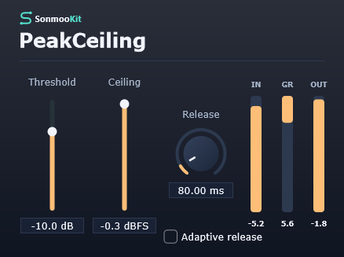

# PeakCeiling

[← Voltar ao catálogo SonmooKit](../../README.md#manuais-ilustrados)

Limitador de picos. Referência funcional: L1.

## Primeiro ajuste

Para segurar os picos de uma bateria, defina **Ceiling** como o nível máximo de saída desejado. Baixe **Threshold** até **GR** reagir às batidas mais fortes. Se a redução continuar entre batidas, encurte **Release** ou suba o limiar.

## Controles do painel

| Controle | Como usar |
| --- | --- |
| **Threshold** | De −36 a 0 dB. Baixar o limiar aumenta o nível enviado ao limitador e a redução aplicada aos picos. |
| **Ceiling** | De −18 a 0 dBFS. Define o teto dos picos de amostra da saída. |
| **Release / Adaptive release** | A recuperação manual vai de 0,01 a 1000 ms. Ative a opção adaptativa para variar o retorno do ganho conforme o histórico dos picos. |
| **IN / GR / OUT** | IN e OUT indicam picos. GR mostra quanto foi necessário atenuar para respeitar o teto. |

## O que ouvir

Se o grave ficar áspero durante notas longas, alivie Threshold e experimente um Release mais longo. Para uma entrega especificada em dBTP, confira o arquivo exportado com um medidor de true peak.
