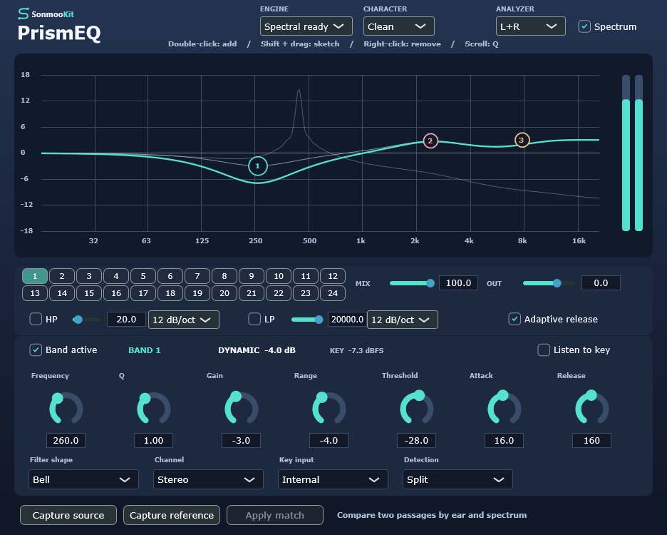

# PrismEQ 0.14.0

[Catálogo SonmooKit](../../README.md) · [Pesquisa e comparação com o Pro-Q 4](../prismeq-referencia.md)

Equalizador VST3 x64 para o Mixer do FL Studio. Ele abre com a curva plana e 24 posições de banda disponíveis. Use **Live** para monitorar uma voz durante a gravação. Use **Spectral ready** quando precisar atenuar uma ressonância sem baixar toda a região. Para ouvir o ponto de partida, deixe **Character** em **Clean** e **Mix** em 100%.

## Editar a curva

| Ação | Resultado |
| --- | --- |
| Dois cliques em um espaço livre | Cria uma banda Bell nessa frequência e nesse ganho. |
| Arrastar um ponto | Na horizontal, muda a frequência. Na vertical, muda o ganho dos filtros que têm ganho. |
| Rolar sobre o ponto | Ajusta Q. Um valor maior estreita uma banda Bell. |
| Alt + dois cliques em um espaço livre | Procura o maior pico próximo no espectro visível e posiciona uma banda nele. |
| Shift + arrastar da esquerda para a direita | Esboça uma curva. Ao soltar, o PrismEQ cria uma banda Bell no extremo de cada trecho acima ou abaixo da linha central. |
| Clique direito no ponto | Desativa a banda e libera sua posição. |
| Escolher um número | Exibe os parâmetros daquela banda. **Band active** permite ligá-la ou desligá-la mantendo seus ajustes. |

Os campos numéricos permitem ajustes precisos. O gráfico cobre 16 Hz a 21 kHz e ±18 dB. Há oito formas por banda: Bell, Low Shelf, High Shelf, High Cut, Low Cut, Notch, Band Pass e All Pass. Os controles de ganho atuam em Bell e nos dois shelves. All Pass altera a fase. Os cortes globais **HP** e **LP** oferecem 6, 12, 18 ou 24 dB/oitava.

## Dinâmica e sidechain

1. Comece com uma banda **Bell**, **Gain** em 0 e **Range** em −6 dB. O sinal permanece próximo da curva estática até atingir o **Threshold**.
2. Em **Split**, o nível da região selecionada controla a banda inteira. **Wide** usa um detector de banda larga. **Listen to key** permite ouvir o detector. **Attack** e **Release** definem a velocidade dessa reação. **Adaptive release** modifica a recuperação da dinâmica convencional.
3. Para uma ressonância que aparece só em algumas sílabas, escolha **Spectral ready** no topo e **Spectral** em **Detection**. Cada faixa estreita da FFT tem seu próprio detector. A frequência e o Q delimitam a área de atuação. O indicador **Dynamic** mostra o maior movimento da banda; a curva estática e o espectro de saída ajudam a interpretar o resultado.
4. Um **Range** positivo permite reforço dinâmico. Em estéreo, escolha **Stereo**, **Mid**, **Side**, **Left** ou **Right** por banda. Em mono, o processamento usa o canal disponível.
5. Para abrir espaço no instrumental quando a voz entra, envie a voz ao insert do instrumental como sidechain, conecte a entrada auxiliar no wrapper do FL Studio e escolha **External** na banda. Use **Listen to key** para conferir o roteamento.

**Live** processa os filtros e a dinâmica convencional com zero amostras de latência reportada. Bandas configuradas como Spectral mantêm apenas sua curva estática nesse modo. **Spectral ready** introduz 1.024 amostras (21,3 ms a 48 kHz), inclusive com as bandas planas. A compensação é informada ao host. Escolha o motor antes de gravar ou iniciar uma passagem crítica.

## Comparar timbres

Reproduza a passagem de origem e clique em **Capture source**. Depois envie a referência à mesma instância e clique em **Capture reference**, mantendo a mesma seleção do analisador. Cada captura reúne 48 quadros com sinal. **Pre L+R** mede a entrada; as outras opções medem a saída. Feita a captura, volte a reproduzir a origem e clique em **Apply match**.

O PrismEQ compara sete regiões entre 80 Hz e 5,12 kHz, desconta a diferença média de volume e acrescenta bandas nas posições livres. A correção por região fica limitada a ±9 dB e regiões com pouca energia são ignoradas. Confira o resultado alternando **Band active**. As bandas ficam salvas no projeto; os perfis capturados duram enquanto o painel está aberto.

## Saída e projeto

**Clean** preserva o processamento linear dos filtros estáticos. **Soft** e **Dense** acrescentam saturação em intensidades diferentes. **Mix** mistura o sinal original alinhado no tempo ao processado. **Out** ajusta o nível final. O espectro e os medidores permitem acompanhar o efeito durante a reprodução. Os parâmetros das bandas, o motor e os controles de saída aceitam automação e são salvos pelo host.

Para instalar, copie a pasta completa **PrismEQ.vst3** para `C:\Program Files\Common Files\VST3\SonmooKit`. No FL Studio, abra **Options → Manage plugins → Find installed plugins** e procure **PrismEQ**.
