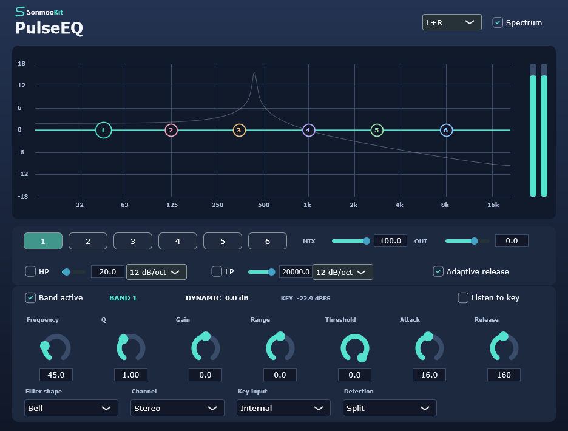

# PulseEQ

[← Voltar ao catálogo SonmooKit](../../README.md#manuais-ilustrados)

Equalizador dinâmico. Referência funcional: F6.

## Primeiro ajuste

Para atenuar uma ressonância só quando ela aparece, selecione uma banda **Bell**, ajuste a frequência e mantenha **Gain** em 0 dB. Coloque **Range** em −4 dB e baixe **Threshold** até a curva dinâmica se mover nas passagens fortes.

## Controles do painel

| Controle | Como usar |
| --- | --- |
| **Band active / Filter shape / Q** | Ative uma das seis bandas e escolha Bell, Low Shelf ou High Shelf. Aumente Q para concentrar a ação da banda Bell. |
| **Gain / Range** | Gain fixa a curva de base. Range limita a ação dinâmica a ±18 dB. Valores negativos atenuam e positivos reforçam. |
| **Threshold / Attack / Release** | O limiar vai de −60 a 0 dB. O ataque vai de 0,5 a 500 ms e a recuperação, de 5 a 5000 ms. Adaptive release adapta essa recuperação ao sinal. |
| **Stereo / Mid / Side** | Escolha se a banda trata os dois canais, o centro ou a componente lateral. |
| **Internal / External / Split / Wide** | Internal detecta a própria pista. External usa a entrada auxiliar. Split filtra a escuta da banda e Wide considera a faixa inteira. |
| **HP / LP** | Escolha o corte e a inclinação de 6, 12, 18 ou 24 dB por oitava. |
| **Spectrum / Mix / Out** | Escolha L+R, Left, Right ou Side no analisador. Mix dosa o efeito e Out ajusta o nível final. |

## Sidechain com outra pista

Para a voz abrir espaço na base, insira PulseEQ na base e encaminhe a voz para ela como sidechain no Mixer. Atribua o envio à entrada auxiliar do wrapper, selecione External na banda e ative Listen to key. Quando ouvir a voz no detector, desligue a escuta e ajuste Threshold com Range negativo.
