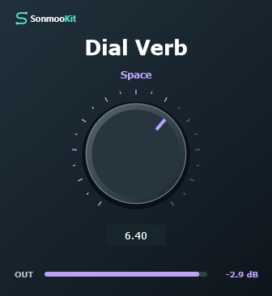

# Dial Verb

[← Catálogo SonmooKit](../../README.md#manuais-ilustrados) · [Guia da série e referências](../serie-um-controle.md)

**Ambiência e reverb.** Combina o som direto com uma reverberação algorítmica. A macro aumenta a presença e a sustentação da cauda e suaviza os agudos à medida que o espaço cresce.

## Controles

**Space** vai de 0 a 10. O ponto neutro é **0**. Dê dois cliques no botão para restaurá-lo. O medidor **OUT** mostra o pico de saída em dBFS.

Aceita entrada e saída mono, estéreo e entrada mono com saída estéreo. O efeito conserva som direto em toda a faixa e foi pensado para uso em insert.

## Primeiro ajuste no FL Studio

Em um insert de voz, toque uma frase com uma pausa no final. Comece em 2 e suba aos poucos. Use a pausa para avaliar a duração da cauda e volte ao trecho cantado para conferir a inteligibilidade.

O parâmetro Space aceita automação e seus ajustes são salvos com o projeto. Referência de uso: [Waves OneKnob Wetter](https://www.waves.com/plugins/oneknob-wetter).
