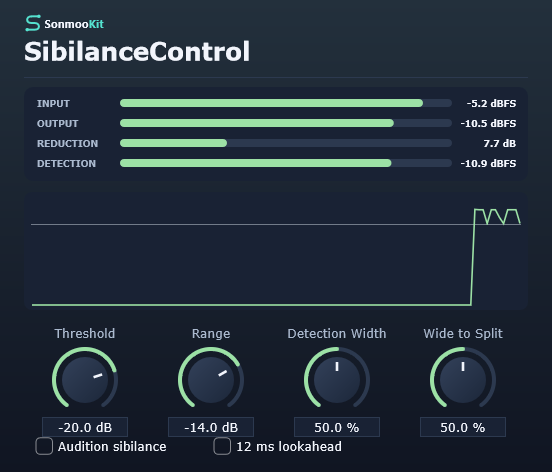

# SibilanceControl

[← Voltar ao catálogo SonmooKit](../../README.md#manuais-ilustrados)

Controle de sibilância. Referência funcional: Sibilance.

## Primeiro ajuste

Repita um trecho com sons de “s” e “ch”. Ative **Audition sibilance** para ouvir os trechos identificados pelo detector. Ajuste **Detection Width** e **Threshold** até destacar essas consoantes, depois desligue a audição para avaliar a voz inteira.

## Controles do painel

| Controle | Como usar |
| --- | --- |
| **Threshold / Detection Width** | O limiar vai de −80 a 0 dB. Width estreita ou amplia a faixa usada para reconhecer as consoantes. |
| **Range** | De −48 a 0 dB. Limita quanto uma consoante pode ser atenuada. Em 0 dB, a audição do detector ainda funciona. |
| **Wide to Split** | Em 0%, a redução afeta todo o sinal durante a consoante. Em 100%, concentra-se acima de aproximadamente 4 kHz. |
| **Audition sibilance** | Reproduz os trechos detectados. Desligue depois de ajustar o detector para ouvir a voz completa. |
| **12 ms lookahead** | Ative para antecipar a ação em 12 ms. Desligado, o efeito declara zero amostras de latência. |
| **Detection / Reduction** | Compare os disparos do detector com a atenuação realmente aplicada. |

## O que ouvir

Se o detector incluir vogais, suba Threshold ou estreite Detection Width. Se ele identificar as consoantes certas, mas a dicção perder clareza, aproxime Range de 0 dB.
