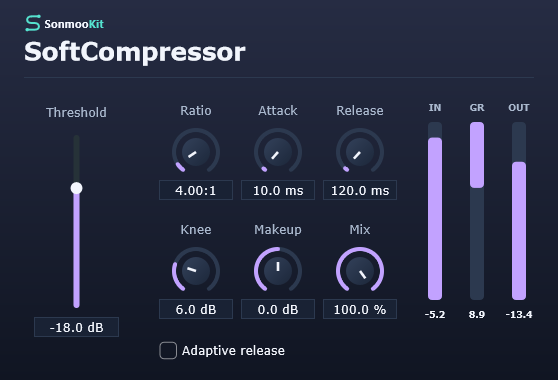

# SoftCompressor

[← Voltar ao catálogo SonmooKit](../../README.md#manuais-ilustrados)

Compressão de dinâmica. Referência funcional: Renaissance Compressor.

## Primeiro ajuste

Para nivelar uma voz, comece com **Ratio** em 4:1, **Attack** em 10 ms e **Release** em 120 ms. Baixe **Threshold** até o medidor **GR** indicar redução nas palavras mais fortes. Compare o nível de saída com o de entrada e ajuste **Makeup**.

## Controles do painel

| Controle | Como usar |
| --- | --- |
| **Threshold / Ratio** | O limiar vai de −60 a 0 dB. Acima de 1:1 há compressão. Abaixo de 1:1, o efeito expande os trechos que ultrapassam o limiar. |
| **Attack / Release** | O ataque vai de 0,5 a 500 ms. A recuperação vai de 5 a 5000 ms. Use o início das batidas para acertar Attack e o espaço entre elas para acertar Release. |
| **Knee** | De 0 a 24 dB. Valores maiores tornam gradual a entrada da compressão perto do limiar. |
| **Adaptive release** | Ajusta a recuperação conforme a duração e a intensidade da ação do detector. |
| **Makeup / Mix** | Makeup compensa o volume em até ±30 dB. Mix permite recuperar parte do sinal original. |
| **IN / GR ou EXP / OUT** | Compare os níveis de entrada e saída. O medidor central mostra a variação de ganho. |

## O que ouvir

Se a caixa perder o estalo inicial, aumente Attack. Se a voz continuar baixa na sílaba seguinte, encurte Release e confira se GR volta em direção a zero.
