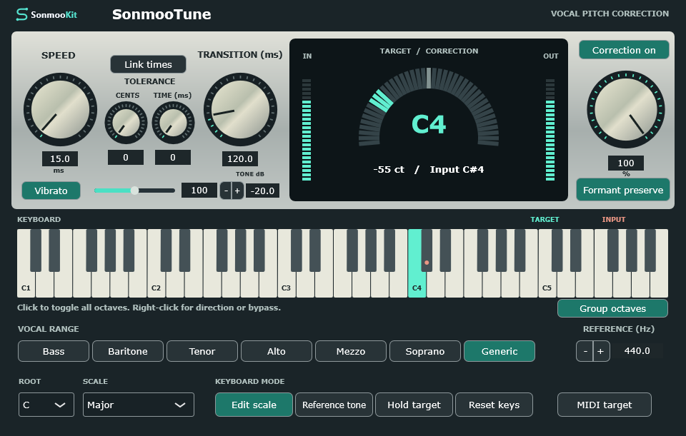

# SonmooTune

[← Voltar ao catálogo SonmooKit](../../README.md#manuais-ilustrados)

Correção de afinação vocal. Referência funcional: Waves Tune Real-Time.

## Primeiro ajuste

Use uma voz isolada. Escolha a extensão vocal, a tônica e a escala da música. Ligue **Correction** e ajuste sua intensidade. Reduza **Speed** para corrigir mais rápido e aumente **Transition** para suavizar as passagens entre notas. O visor permite comparar entrada e alvo.

## Controles do painel

| Controle | Como usar |
| --- | --- |
| **Vocal range / Root / Scale** | Escolha a extensão do cantor, a tônica e a escala. Use Generic se a extensão for desconhecida, depois restrinja se necessário. |
| **Speed / Transition / Link times** | Speed define a rapidez da correção e Transition suaviza as mudanças de alvo. Ambos vão de 0 a 800 ms. Link times usa Speed nas transições. |
| **Tolerance Cents / Time** | Aumente a margem em cents ou o tempo antes da mudança de alvo. Com ambos ativos, a primeira condição atingida libera a troca. |
| **Correction / Formant preserve / Vibrato** | Controle a intensidade da afinação, a preservação do timbre das vogais e a quantidade de vibrato mantida. Vibrato vai de 0 a 200%. |
| **Edit scale / Group octaves / Reset keys** | Clique para incluir ou excluir notas. O botão direito oferece direção da correção ou bypass. Group octaves aplica a regra às outras oitavas. Reset keys restaura a escala. |
| **Reference / Reference tone / Hold target** | A referência vai de 415 a 466 Hz. Em Reference tone, segure uma tecla para ouvi-la. Em Hold target, segure a nota para direcionar a correção. |

## Controle pelo Piano Roll

Para usar uma melodia do Piano Roll, iguale a porta do MIDI Out à porta MIDI de entrada do wrapper e ative MIDI target. Toque a voz e o MIDI juntos. Ao soltar as notas, a escala volta a determinar o alvo. No teclado, verde indica o alvo e o ponto coral indica a entrada.
