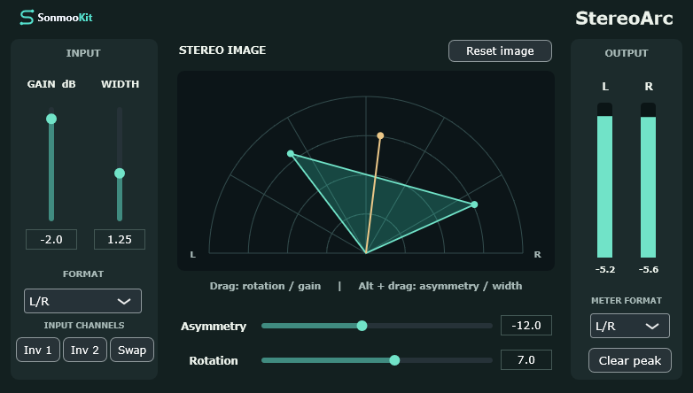

# StereoArc

[← Voltar ao catálogo SonmooKit](../../README.md#manuais-ilustrados)

Imagem estéreo. Referência funcional: S1 Imager.

## Primeiro ajuste

Para abrir um instrumento estéreo, mantenha a entrada em **L/R**, comece com **Width** em 1 e aumente aos poucos. Em 0, a saída fica mono. Em 3, a componente lateral é triplicada. Confira o resultado também em mono.

## Controles do painel

| Controle | Como usar |
| --- | --- |
| **Format / Inv 1 / Inv 2 / Swap** | Escolha L/R para áudio estéreo convencional e M/S para decodificar um par centro/lateral. Inv inverte a polaridade da entrada e Swap troca os canais. |
| **Gain / Width** | Ganho de −24 a 0 dB. Width em 0 soma em mono, em 1 conserva a largura e em 3 triplica a componente lateral. |
| **Rotation / Asymmetry** | Rotation desloca a imagem inteira em até 45° para cada lado. Asymmetry altera a distribuição lateral em até 90° e mantém uma fonte mono no centro com rotação zero. |
| **Gráfico** | Arraste na horizontal para rotação e na vertical para ganho. Segure Alt para controlar assimetria e largura. |
| **Meter format / Clear peak** | Selecione L/R ou M/S para medir a saída. Clear peak limpa a indicação de pico retida. |
| **Reset image** | Restaura Width para 1 e Rotation e Asymmetry para zero. Ganho e formato de entrada têm ajustes independentes. |

## O que ouvir

Se aumentar Width não abrir o som, observe Side no medidor M/S. Uma fonte idêntica nos dois canais não contém componente lateral para ampliar.
