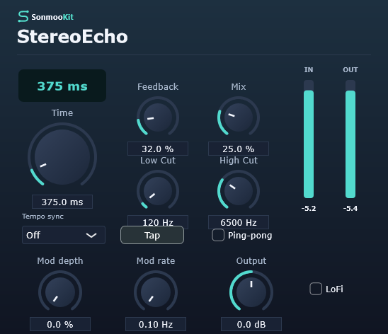

# StereoEcho

[← Voltar ao catálogo SonmooKit](../../README.md#manuais-ilustrados)

Delay sincronizado. Referência funcional: H-Delay.

## Primeiro ajuste

Para encaixar as repetições de uma voz no andamento da música, selecione **1/4** em **Tempo sync**. A 120 BPM, cada repetição fica a 500 ms da anterior. Para acertar o intervalo de ouvido, selecione **Off** e ajuste **Time** entre 1 e 3500 ms. Você também pode clicar duas vezes em **Tap** no ritmo desejado.

## Controles do painel

| Controle | Como usar |
| --- | --- |
| **Time / Tempo sync** | Com Off, o intervalo vai de 1 a 3500 ms. Com uma divisão musical selecionada, o tempo acompanha o BPM do projeto. |
| **Tap** | Clique duas vezes no ritmo da música. Em modo sincronizado, o efeito escolhe a divisão disponível mais próxima. |
| **Feedback** | De 0 a 200%. Em zero há um único eco. Acima de 100%, as repetições podem crescer. |
| **Low Cut / High Cut** | Retiram graves e agudos das repetições. Ajuste enquanto a voz original toca para preservar a clareza das palavras. |
| **Mod depth / Mod rate / LoFi** | Depth e Rate definem a intensidade e a velocidade da variação do tempo. LoFi dá menos definição às repetições. |
| **Mix / Output / Ping-pong** | Mix dosa o eco, Output ajusta a saída e Ping-pong alterna as repetições entre os lados em estéreo. |

## O que ouvir

Se o eco mudar de volume, mas continuar fora do ritmo, selecione 1/4 a 120 BPM e escute uma repetição a cada 500 ms. Para ecos entre as batidas, experimente 1/8 dotted.

Em um canal de retorno dedicado, use **Mix em 100%** e controle a quantidade de eco pelo envio no Mixer. Em um insert, comece com Mix em 25%.
