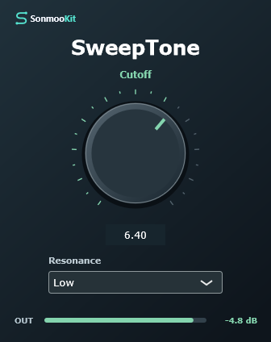

# SweepTone

[← Catálogo SonmooKit](../../README.md#manuais-ilustrados) · [Guia da série e referências](../serie-um-controle.md)

**Filtro ressonante.** Controla um passa-baixas em escala logarítmica. Fechar o controle retira agudos. Perto de 10, a transição traz de volta o som direto até a posição aberta.

## Controles

**Cutoff** vai de 0 a 10. O ponto neutro é **10**. Dê dois cliques no botão para restaurá-lo. O medidor **OUT** mostra o pico de saída em dBFS.

Resonance oferece None, Low, Medium e High. Valores altos destacam a região do corte e podem produzir picos de saída. Confira o medidor ao automatizar.

## Primeiro ajuste no FL Studio

Em um sintetizador rico em harmônicos, comece em 10 com Resonance em Low. Feche até aproximadamente 4 durante um compasso e reabra no início do refrão. Automatize Cutoff para repetir o gesto.

O parâmetro Cutoff aceita automação e seus ajustes são salvos com o projeto. Referência de uso: [Waves OneKnob Filter](https://www.waves.com/plugins/oneknob-filter).
