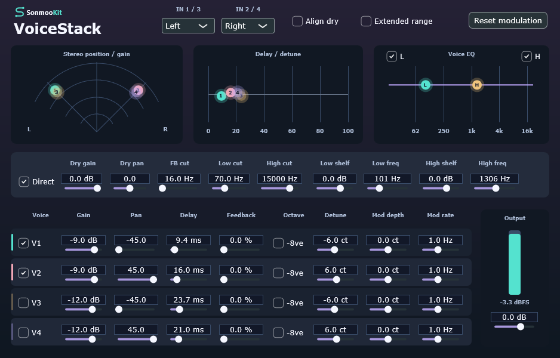

# VoiceStack

[← Voltar ao catálogo SonmooKit](../../README.md#manuais-ilustrados)

Dobra de voz. Referência funcional: Doubler.

## Primeiro ajuste

Para alargar uma voz principal, mantenha **Direct** ligado e use V1 e V2. Experimente delays de 10 e 20 ms, desafinações de −6 e +6 cents e panoramas opostos. Ajuste o ganho das duas cópias até que a voz principal continue em destaque.

## Controles do painel

| Controle | Como usar |
| --- | --- |
| **IN 1/3 e IN 2/4** | Escolha Left, Right ou L+R para cada par de vozes. Os dois seletores permitem alimentar as dobras com fontes diferentes. |
| **V1–V4 / Gain / Pan** | Ative cada cópia e ajuste seu nível e posição. As vozes ligadas aparecem como marcadores coloridos. |
| **Delay / Detune / −8ve** | Cada voz tem atraso de 0 a 100 ms e desafinação de −100 a +100 cents. −8ve abaixa a cópia em uma oitava. |
| **Feedback / FB cut** | Feedback recircula a voz. FB cut tira graves do caminho de realimentação. |
| **Mod depth / Mod rate / Reset modulation** | Ajustam a excursão e a velocidade da modulação. Reset reinicia os osciladores juntos. |
| **Direct / Dry gain / Dry pan / Align dry** | Controlam o original. Align dry alinha o sinal direto à referência das vozes, de 7 ms na faixa normal e 24 ms em Extended range. |
| **Low cut / High cut / Voice EQ / Output** | Os cortes e as prateleiras moldam o timbre das cópias. Output regula a soma final. |

## O que ouvir

Desligue Direct para avaliar apenas as cópias. Se a dobra sumir ao selecionar L+R, escute Left e Right separadamente. Os canais podem estar em oposição de fase.
